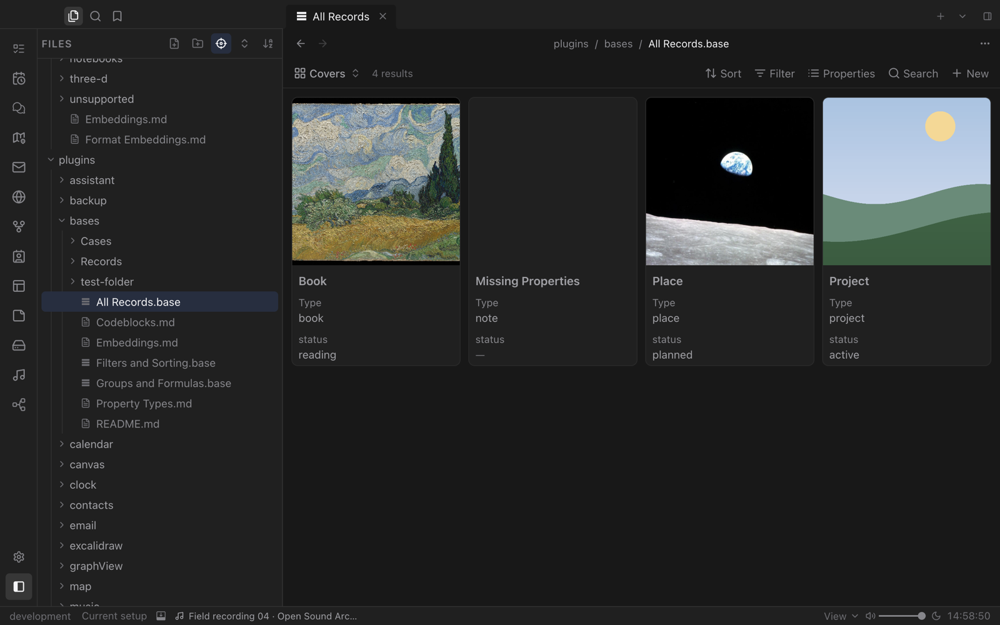
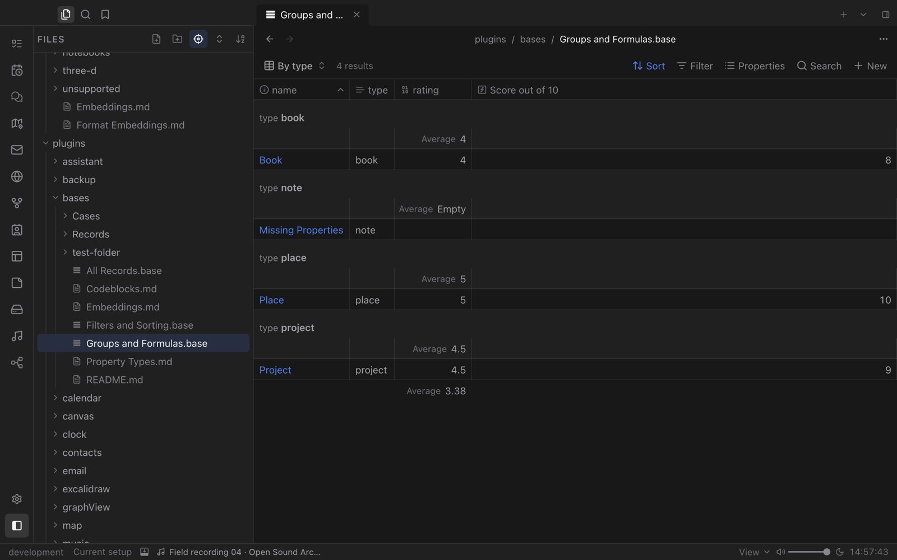
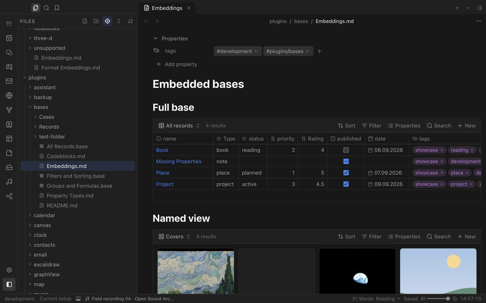

# Bases

Turn notes into databases. Bases builds tables, cards and lists from your files and their properties, with filters, sorting, groups and formulas, and keeps everything in plain Markdown.

## Your notes, as data

A `.base` file describes which notes to include and how to show them. Each note's properties become columns.

- **Table**, **cards** and **list** layouts, each saved as a named view.
- Cover images on cards come straight from a note property.
- Sort, filter and choose visible properties from the toolbar.

## Groups and formulas

Group rows by any property and add summaries such as averages per group. Formulas compute new columns, for example a score out of ten from a rating.

## Bases inside notes

Embed a whole base or one of its named views in any note. Embedded bases stay fully interactive, so a project page can show its live task table or reading list right where you need it.
